# Lane pixels and fitted polynomials

Bird's-eye OR masks with the left boundary in green and the right boundary in red.
Curves bridge dashed-line gaps. Review flags identify insufficient support or implausible geometry.

## challange00101.png

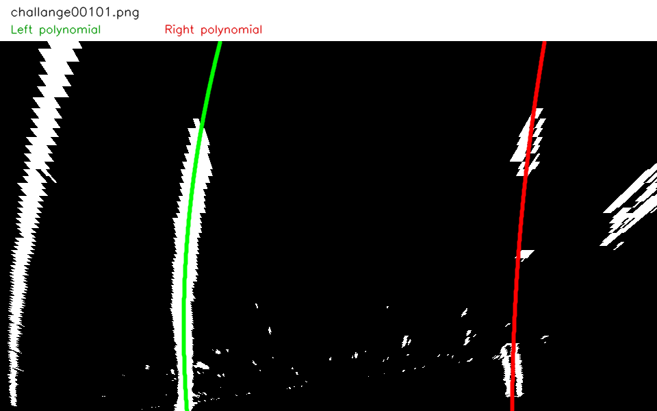

## challange00111.png

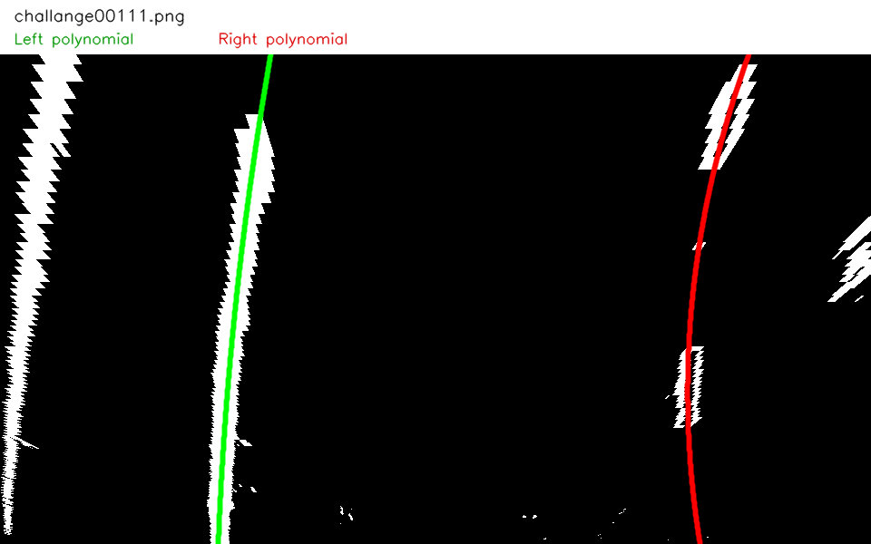

## challange00136.png

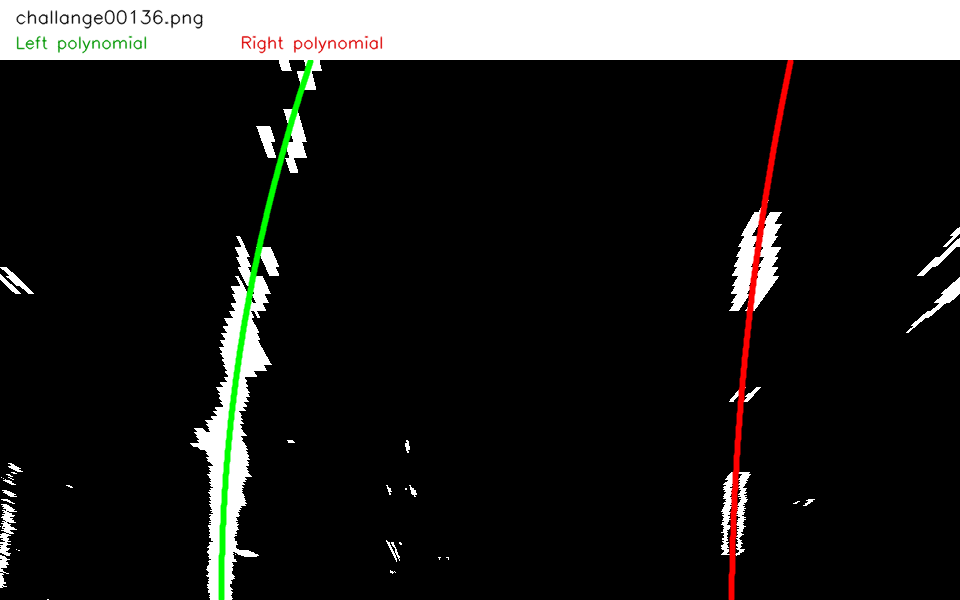

## solidWhiteCurve.png

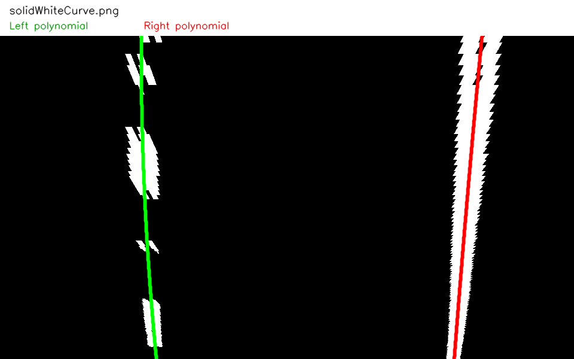

## solidWhiteRight.png

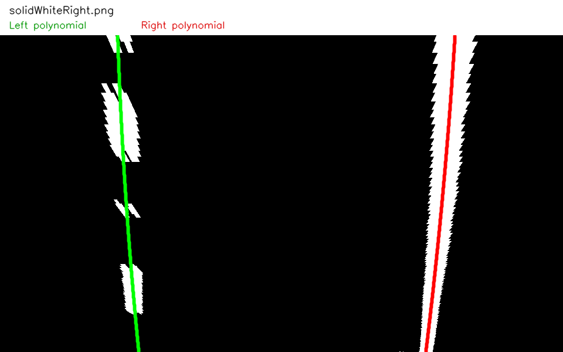

## solidYellowCurve.png

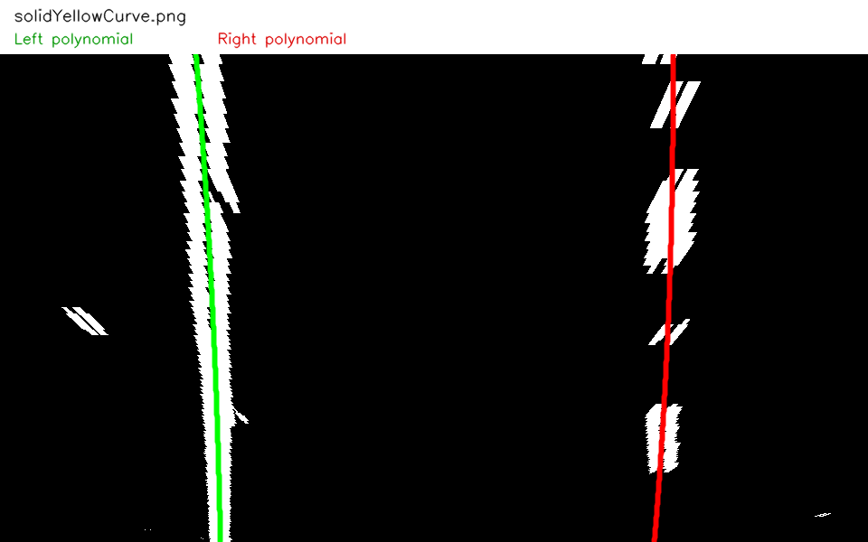

## solidYellowCurve2.png

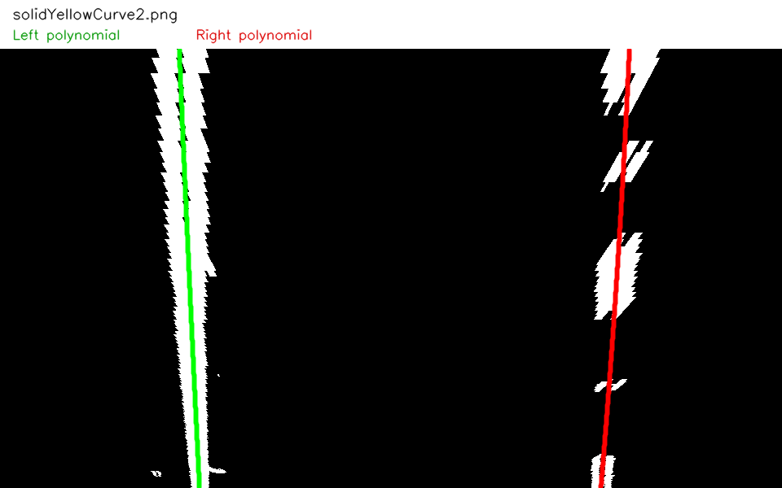

## solidYellowLeft.png

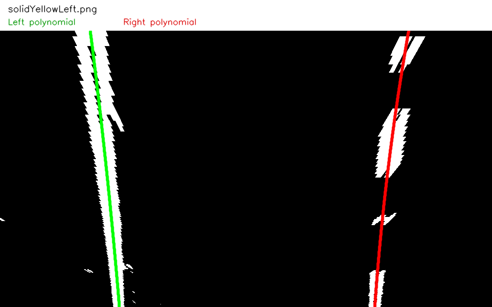

## straight_lines1.png

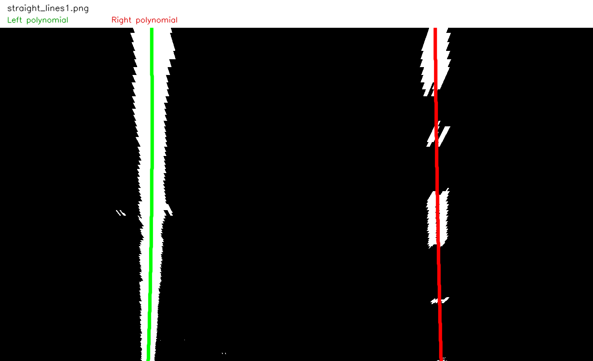

## straight_lines2.png

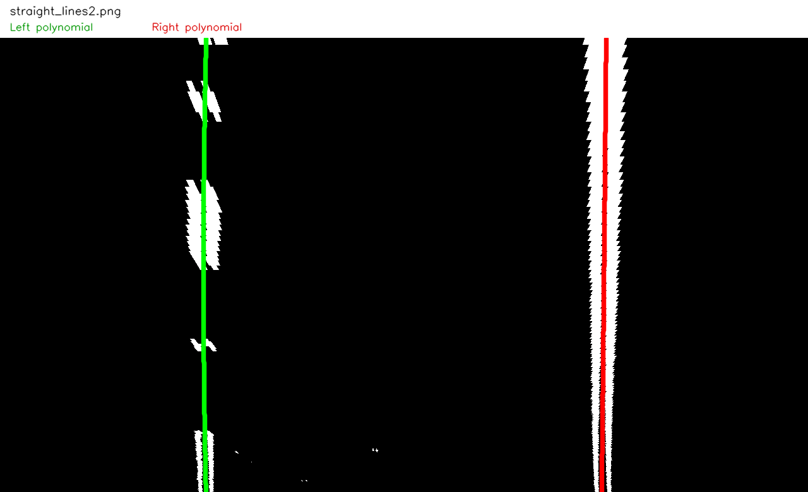

## test1.png

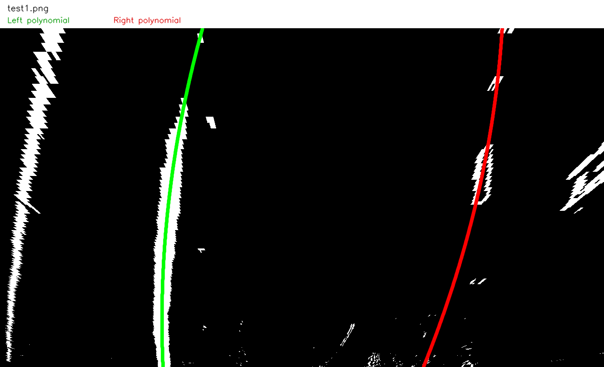

## test2.png

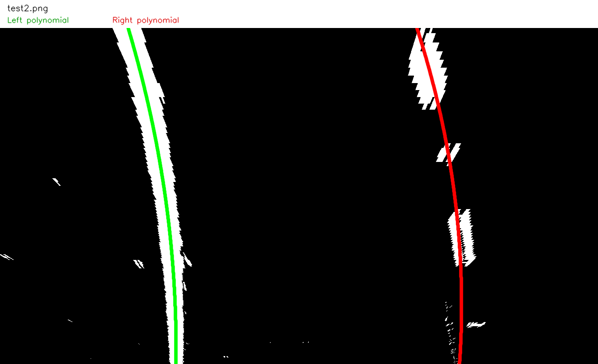

## test3.png

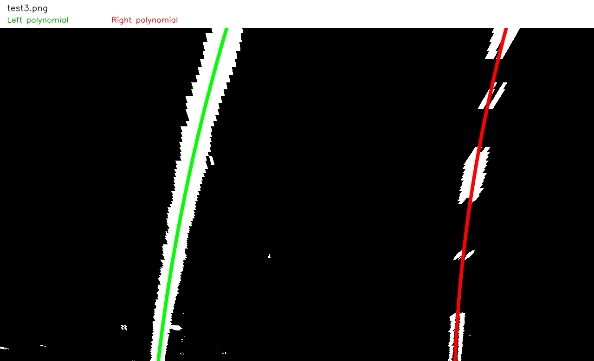

## test4.png

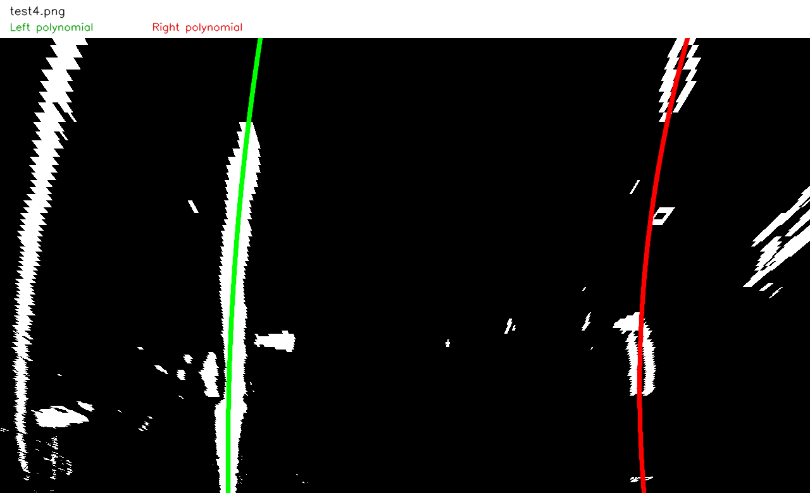

## test5.png

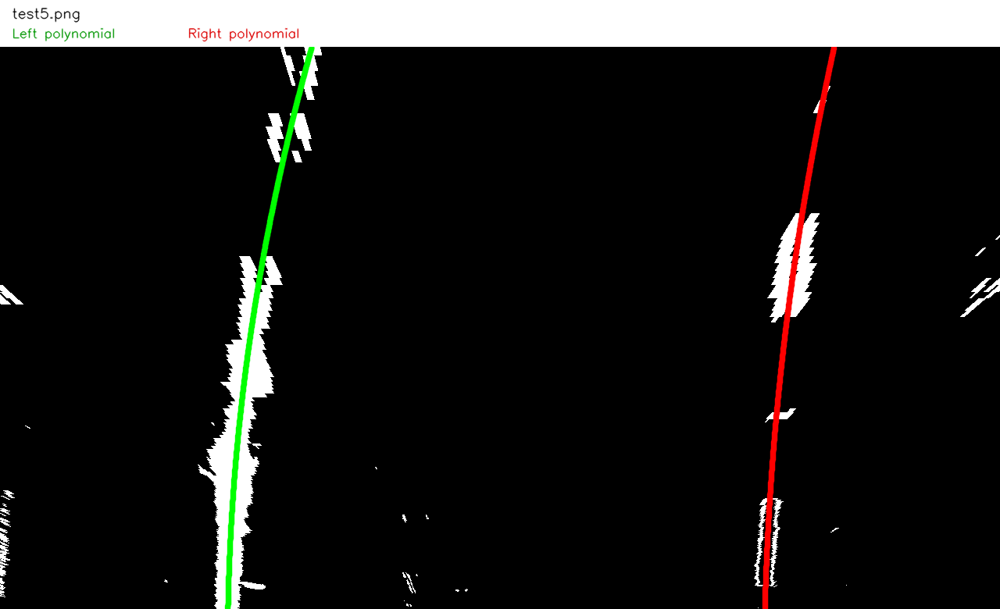

## test6.png

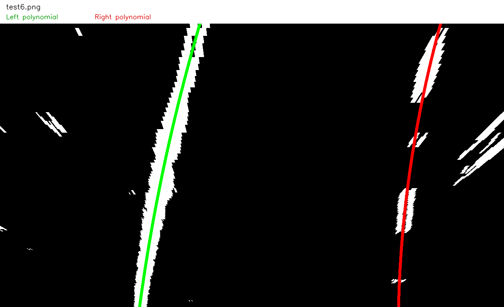

## whiteCarLaneSwitch.png

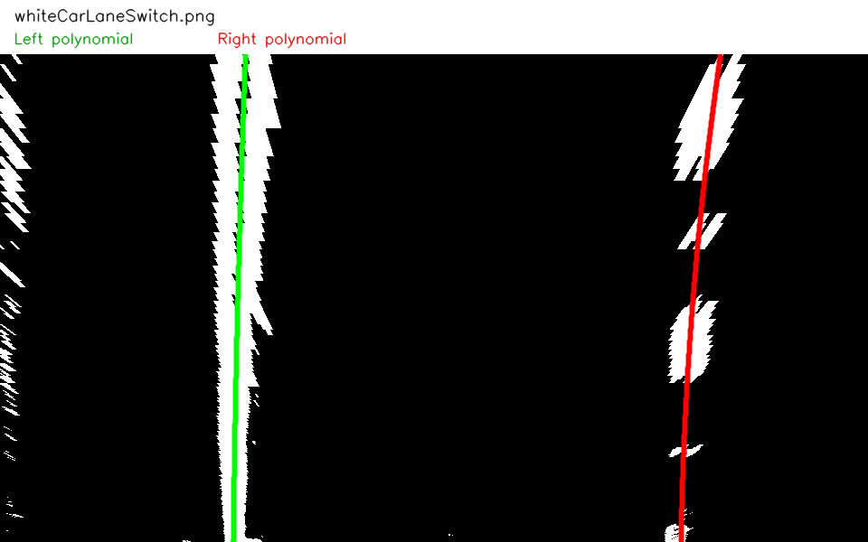
