# Lanes projected onto corrected road images

Green: detected lane area. Cyan: left polynomial. Red: right polynomial.
Overlays cover the road ROI represented in the saved bird's-eye view.
Approximate metrics assume a 3.7 m lane and 30 m of visible road.
Offset uses the nearest visible road row and the configured camera-center reference.

## challange00101.jpg

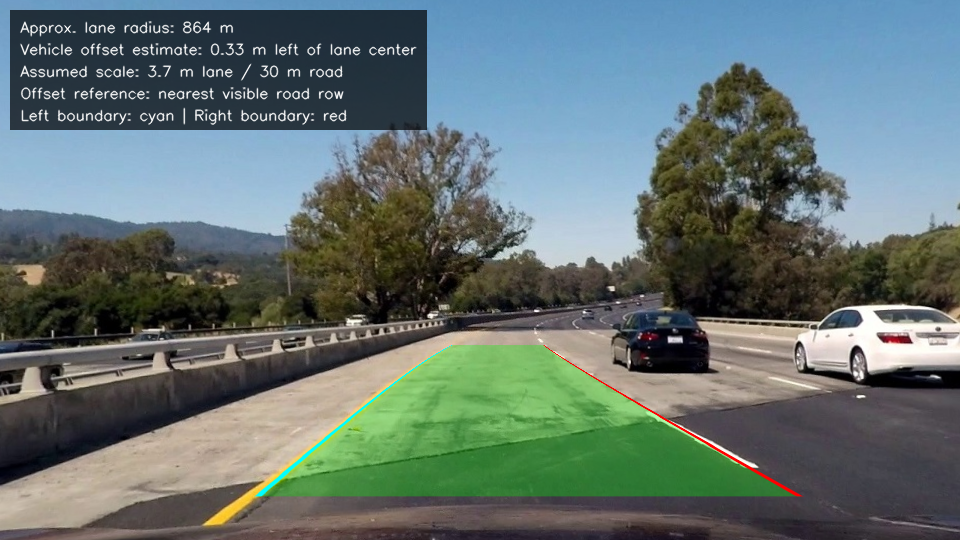

## challange00111.jpg

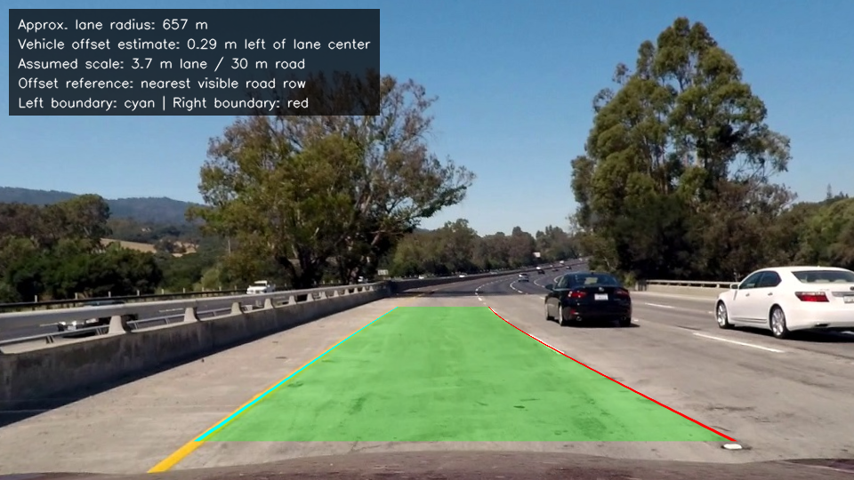

## challange00136.jpg

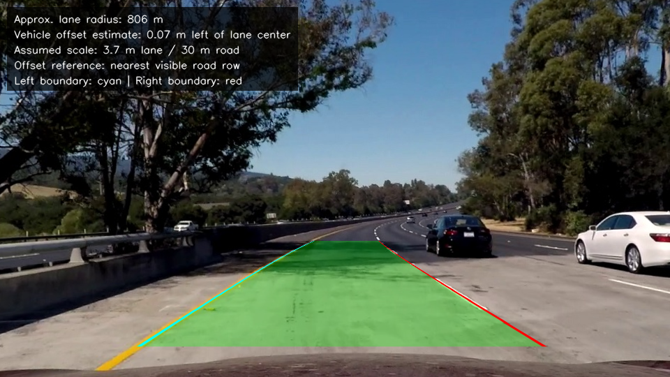

## solidWhiteCurve.jpg

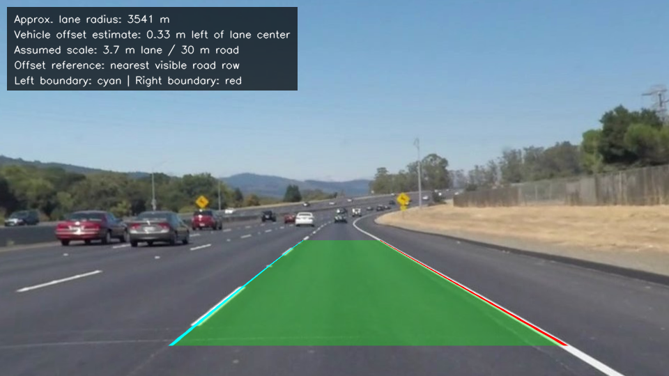

## solidWhiteRight.jpg

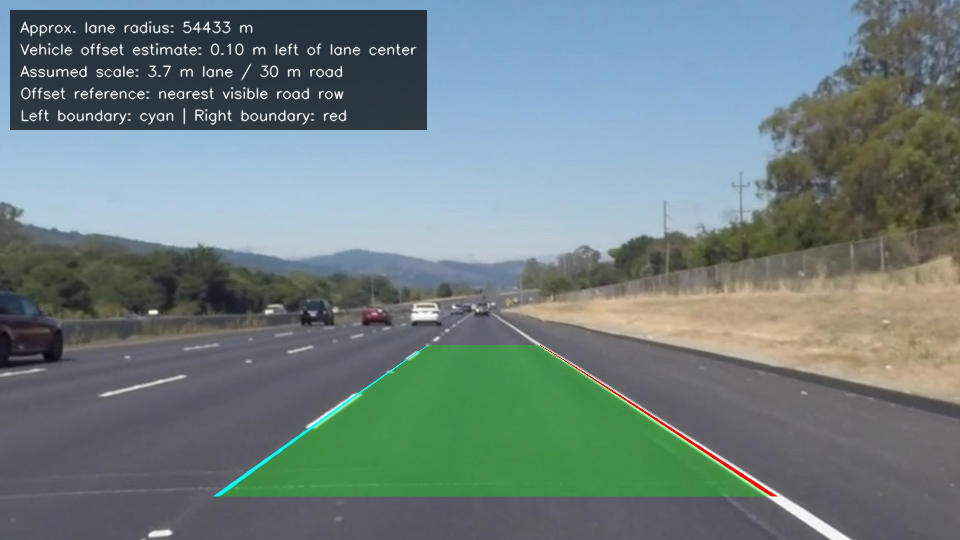

## solidYellowCurve.jpg

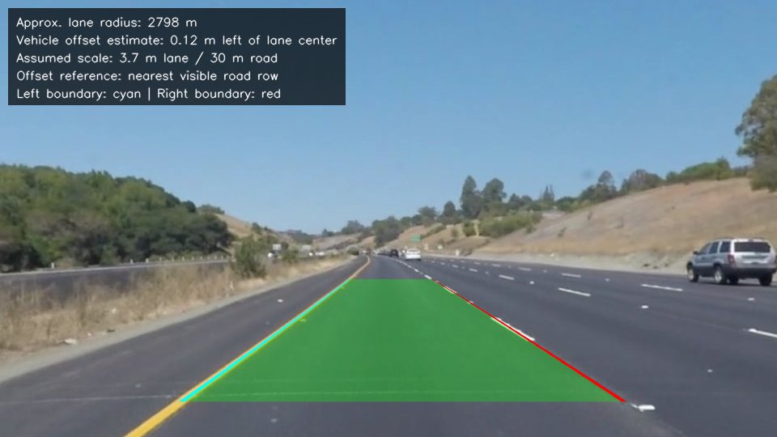

## solidYellowCurve2.jpg

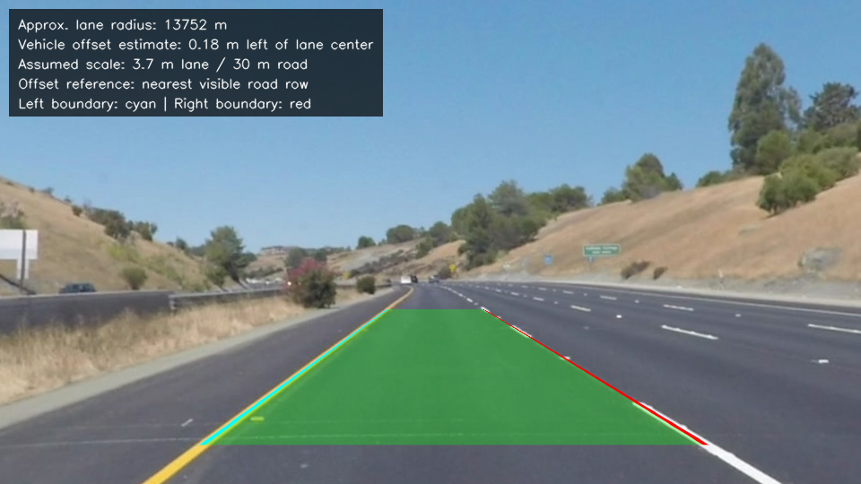

## solidYellowLeft.jpg

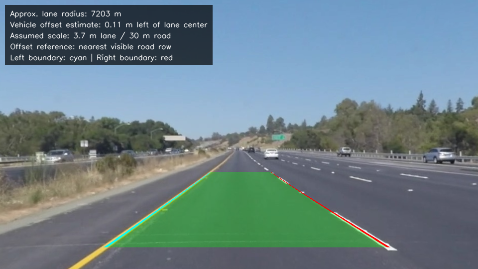

## straight_lines1.jpg

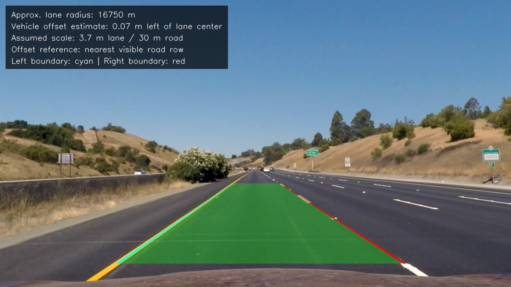

## straight_lines2.jpg

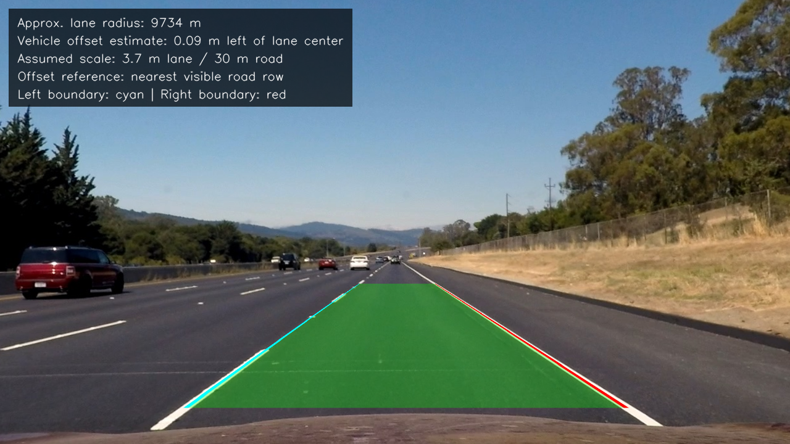

## test1.jpg

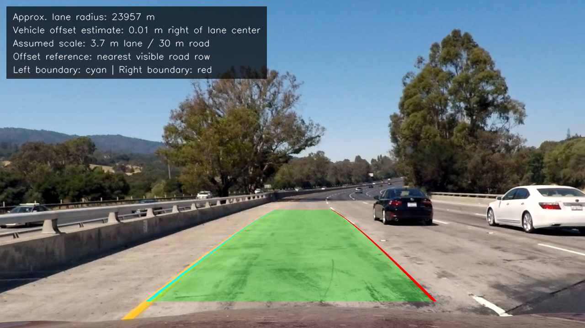

## test2.jpg

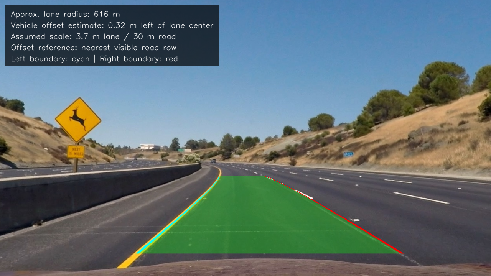

## test3.jpg

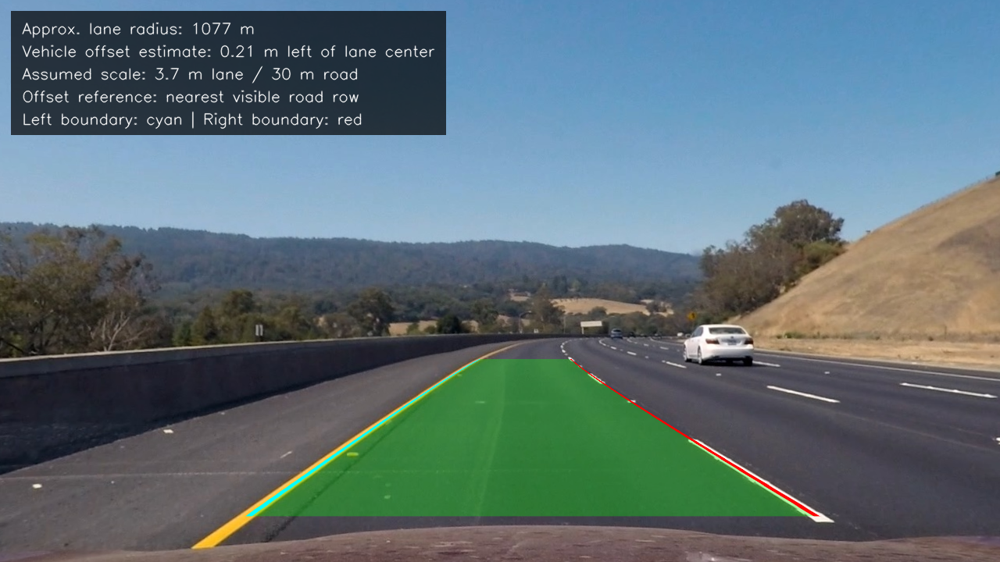

## test4.jpg

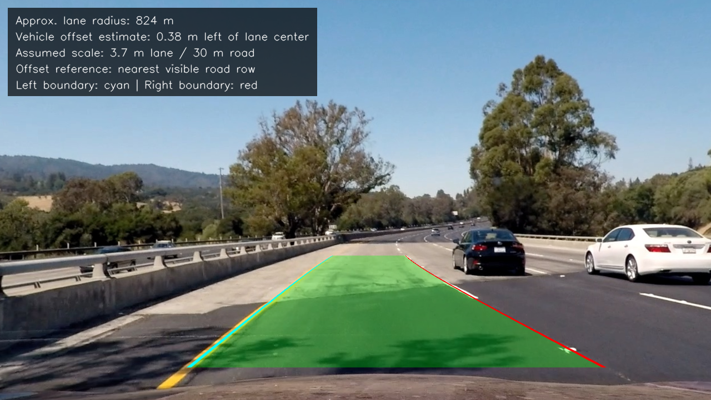

## test5.jpg

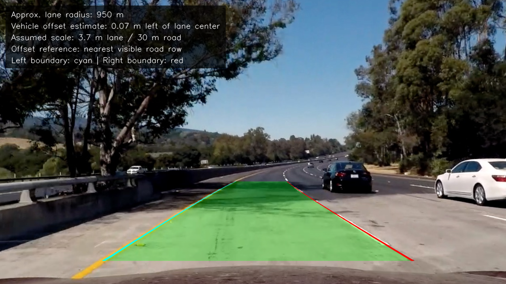

## test6.jpg

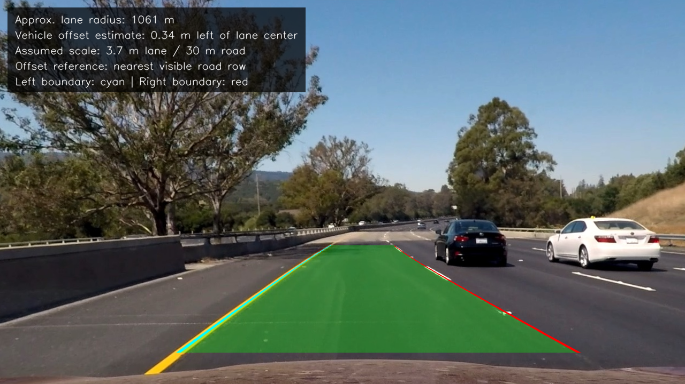

## whiteCarLaneSwitch.jpg

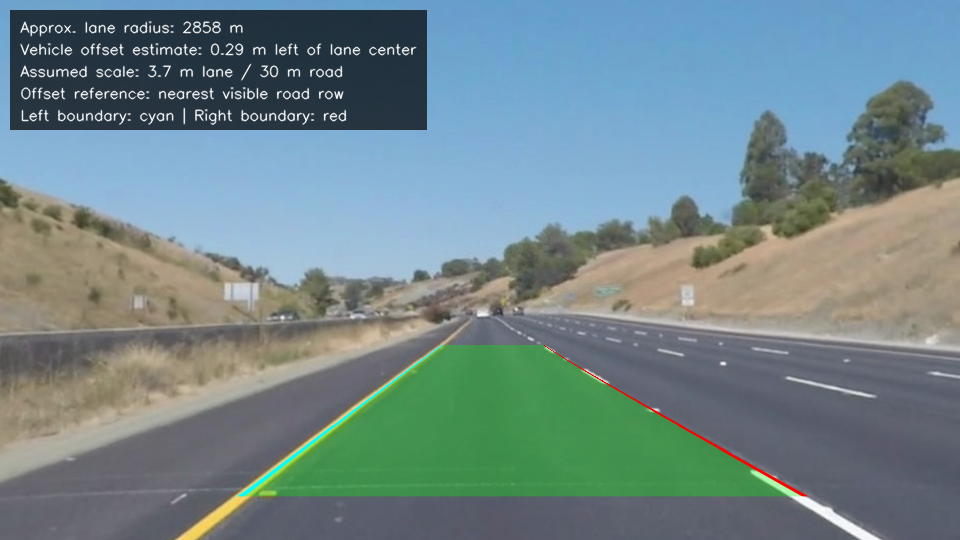
