# Perspective transformation

Left: distortion-corrected image with the visible source ROI outlined in green.
Right: bird's-eye binary mask using the selected OR thresholding method.
The ROI is the inverse projection of the output borders, clipped to the source image.

## challange00101.jpg

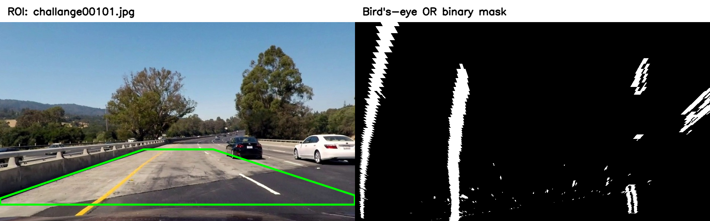

## challange00111.jpg

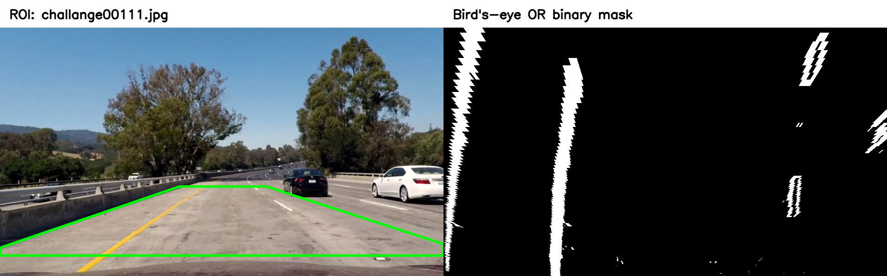

## challange00136.jpg

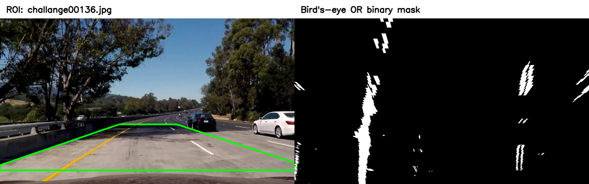

## solidWhiteCurve.jpg

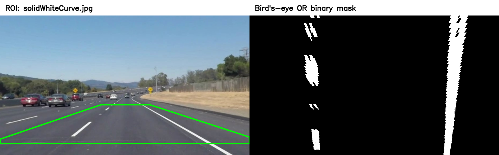

## solidWhiteRight.jpg

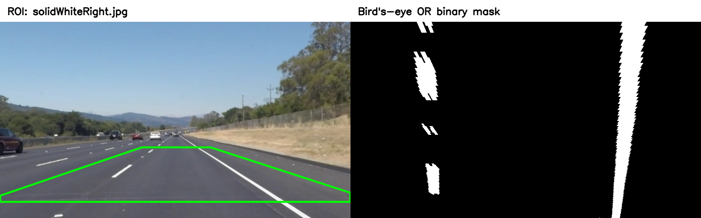

## solidYellowCurve.jpg

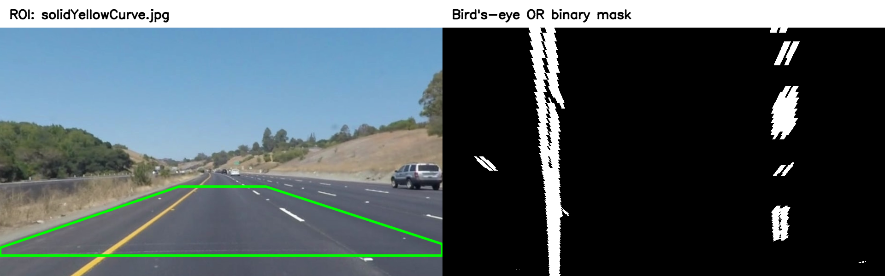

## solidYellowCurve2.jpg

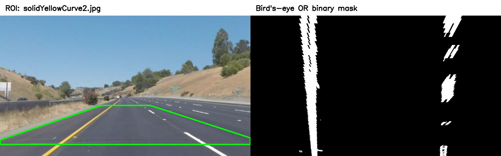

## solidYellowLeft.jpg

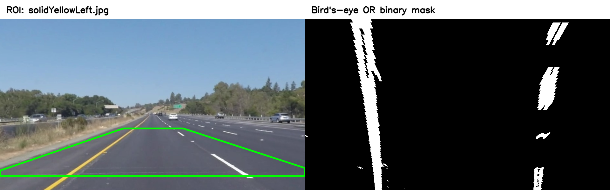

## straight_lines1.jpg

## straight_lines2.jpg

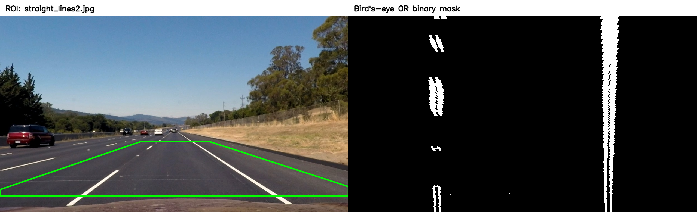

## test1.jpg

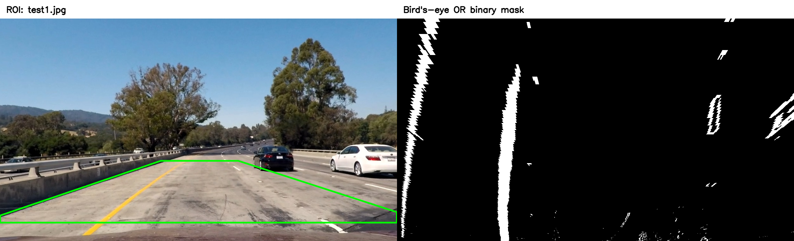

## test2.jpg

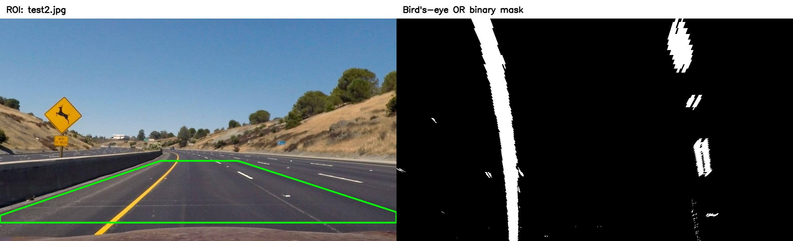

## test3.jpg

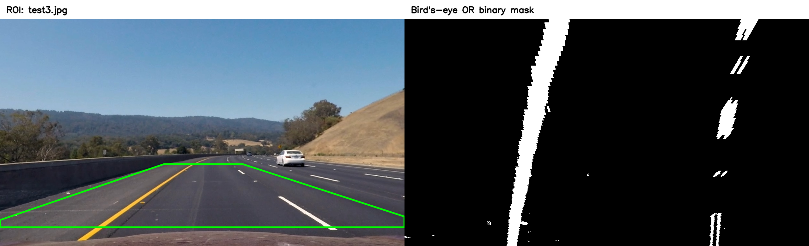

## test4.jpg

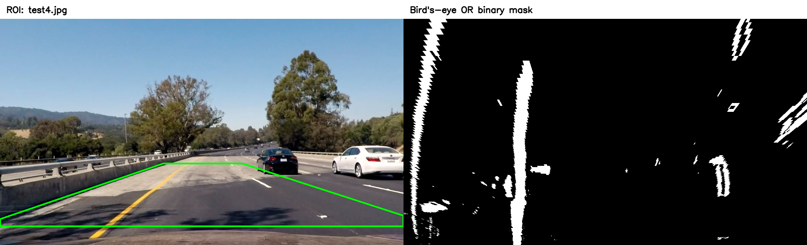

## test5.jpg

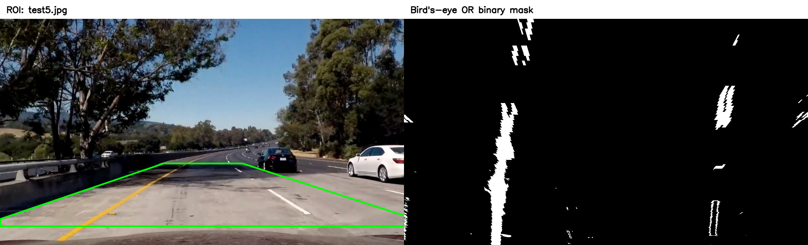

## test6.jpg

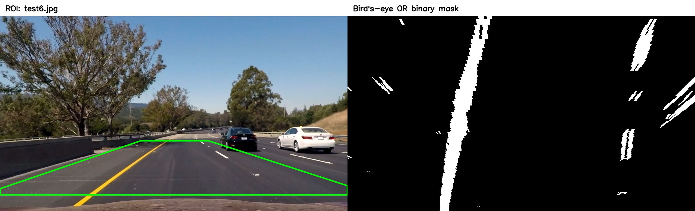

## whiteCarLaneSwitch.jpg

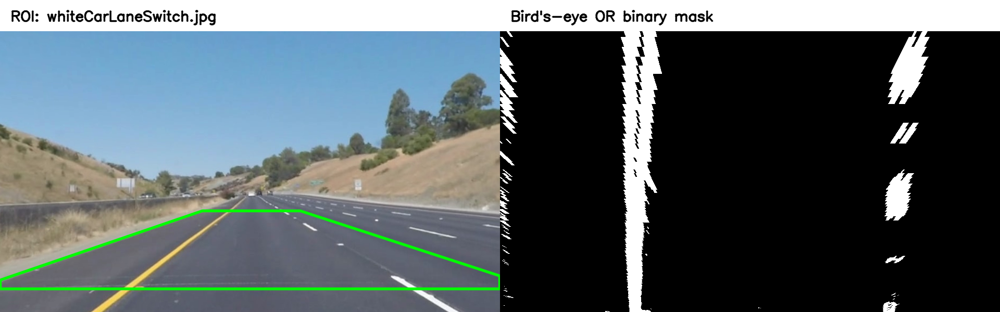
