# Thresholding experiment

All four methods use the same distortion-corrected input and fixed settings.
No ROI is applied. Review lane coverage and unwanted detections before choosing a method.
Active-pixel percentages measure mask density, rather than accuracy.

Panel layout: corrected image / color / gradient; experiment details / OR / AND.
Open a PNG at its original size to inspect thin gradient edges.

| Image | Parameter check or evaluation | Color % | Gradient % | OR % | AND % |
| --- | --- | --- | --- | --- | --- |
| [challange00101.jpg](comparisons/challange00101_comparison.png) | evaluation | 4.50 | 5.20 | 9.31 | 0.39 |
| [challange00111.jpg](comparisons/challange00111_comparison.png) | evaluation | 3.13 | 5.84 | 8.77 | 0.20 |
| [challange00136.jpg](comparisons/challange00136_comparison.png) | evaluation | 1.83 | 9.24 | 10.88 | 0.18 |
| [solidWhiteCurve.jpg](comparisons/solidWhiteCurve_comparison.png) | evaluation | 1.91 | 2.86 | 4.40 | 0.36 |
| [solidWhiteRight.jpg](comparisons/solidWhiteRight_comparison.png) | evaluation | 3.64 | 2.99 | 6.33 | 0.30 |
| [solidYellowCurve.jpg](comparisons/solidYellowCurve_comparison.png) | evaluation | 1.12 | 2.88 | 3.55 | 0.45 |
| [solidYellowCurve2.jpg](comparisons/solidYellowCurve2_comparison.png) | evaluation | 2.32 | 3.92 | 5.53 | 0.71 |
| [solidYellowLeft.jpg](comparisons/solidYellowLeft_comparison.png) | parameter check | 1.21 | 4.08 | 4.65 | 0.64 |
| [straight_lines1.jpg](comparisons/straight_lines1_comparison.png) | parameter check | 13.30 | 2.64 | 14.71 | 1.23 |
| [straight_lines2.jpg](comparisons/straight_lines2_comparison.png) | evaluation | 9.26 | 2.99 | 11.83 | 0.42 |
| [test1.jpg](comparisons/test1_comparison.png) | evaluation | 4.39 | 4.16 | 8.34 | 0.21 |
| [test2.jpg](comparisons/test2_comparison.png) | parameter check | 11.91 | 3.61 | 13.78 | 1.74 |
| [test3.jpg](comparisons/test3_comparison.png) | evaluation | 5.95 | 1.83 | 7.20 | 0.57 |
| [test4.jpg](comparisons/test4_comparison.png) | evaluation | 7.82 | 4.39 | 11.67 | 0.54 |
| [test5.jpg](comparisons/test5_comparison.png) | evaluation | 2.53 | 8.03 | 10.36 | 0.20 |
| [test6.jpg](comparisons/test6_comparison.png) | evaluation | 5.82 | 8.06 | 13.24 | 0.63 |
| [whiteCarLaneSwitch.jpg](comparisons/whiteCarLaneSwitch_comparison.png) | evaluation | 1.42 | 4.52 | 5.25 | 0.68 |

## challange00101.jpg

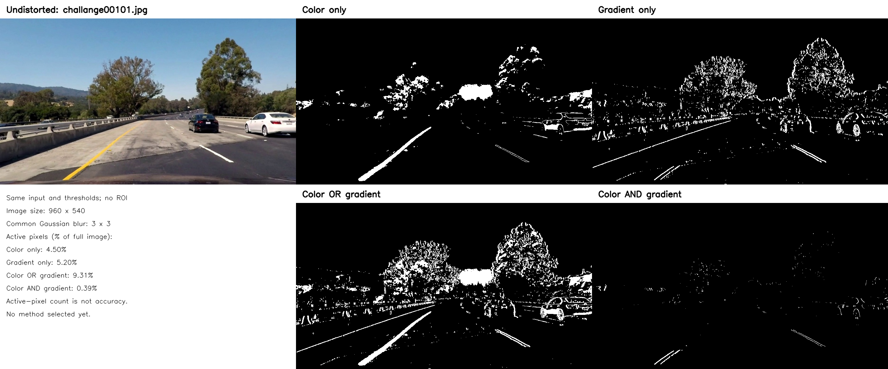

## challange00111.jpg

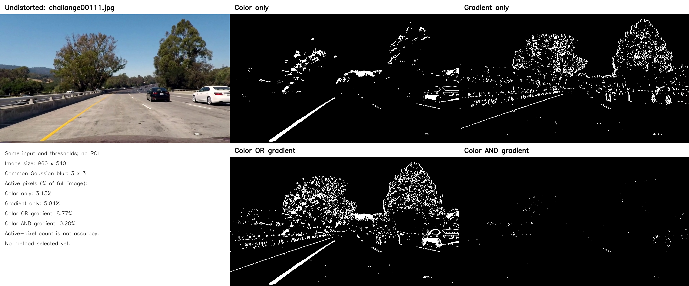

## challange00136.jpg

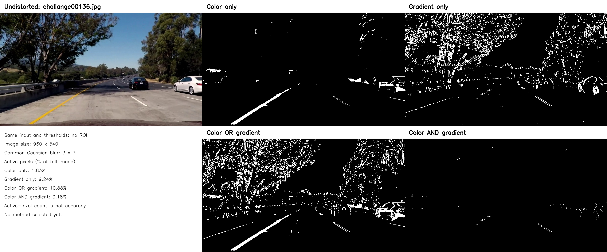

## solidWhiteCurve.jpg

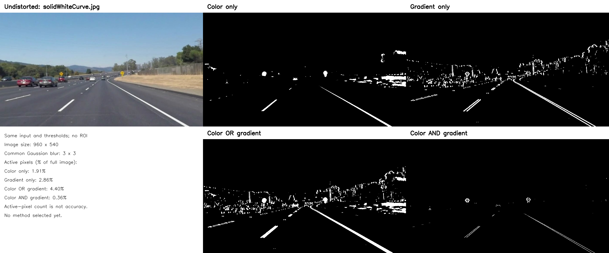

## solidWhiteRight.jpg

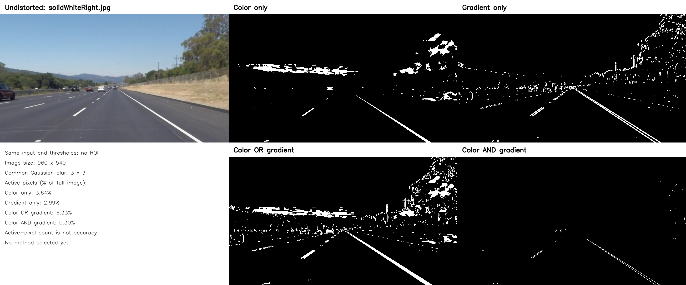

## solidYellowCurve.jpg

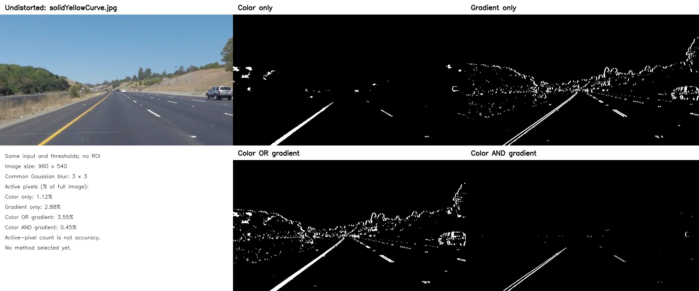

## solidYellowCurve2.jpg

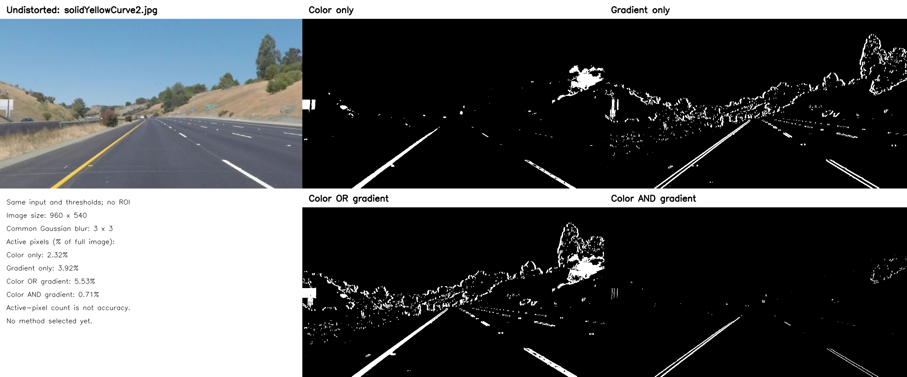

## solidYellowLeft.jpg

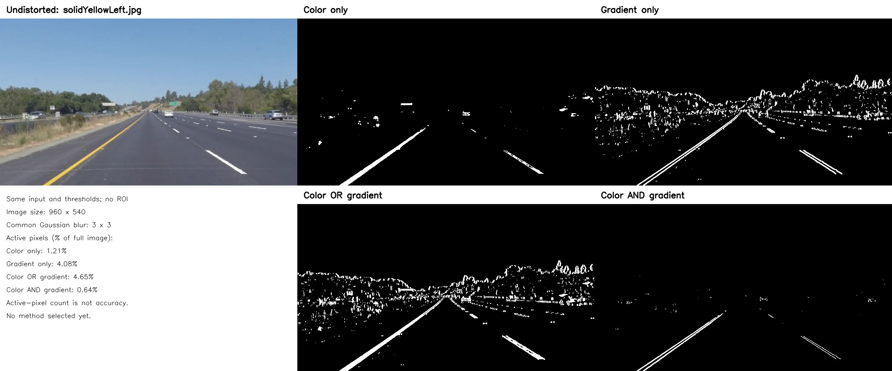

## straight_lines1.jpg

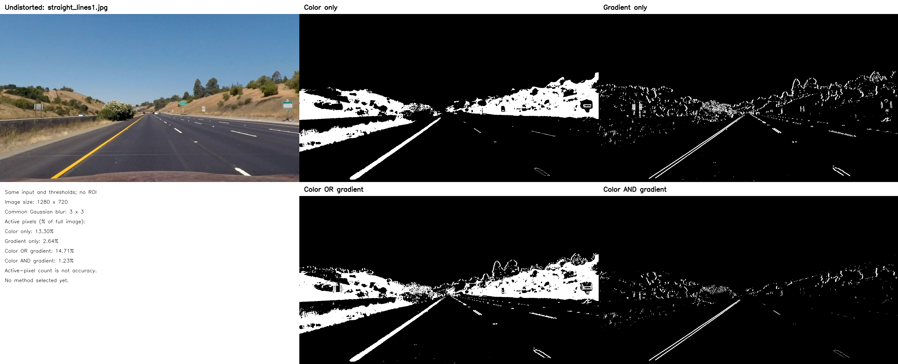

## straight_lines2.jpg

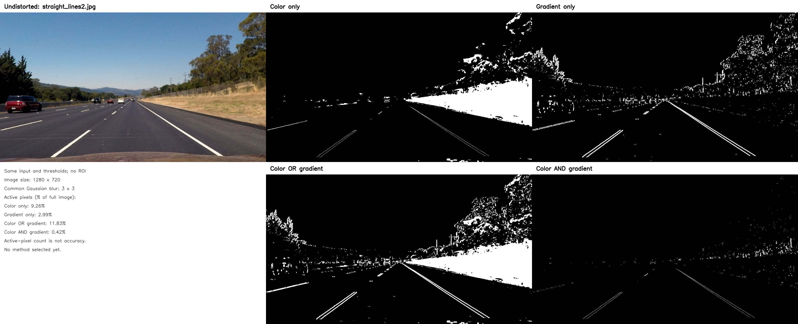

## test1.jpg

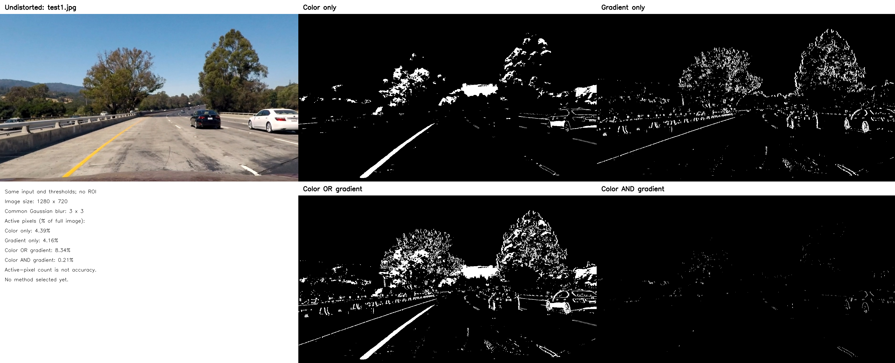

## test2.jpg

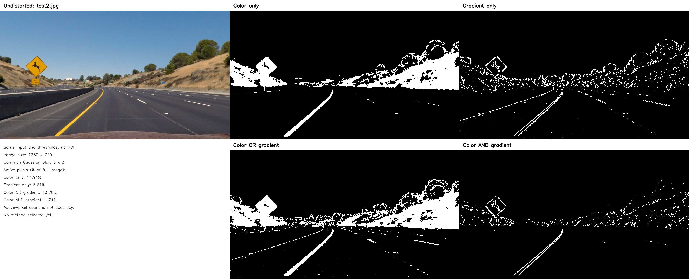

## test3.jpg

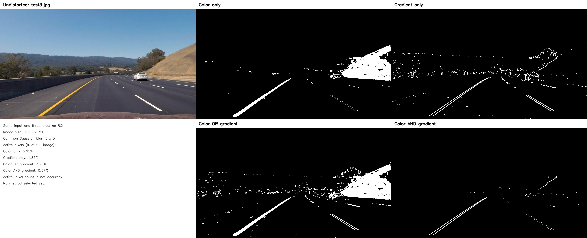

## test4.jpg

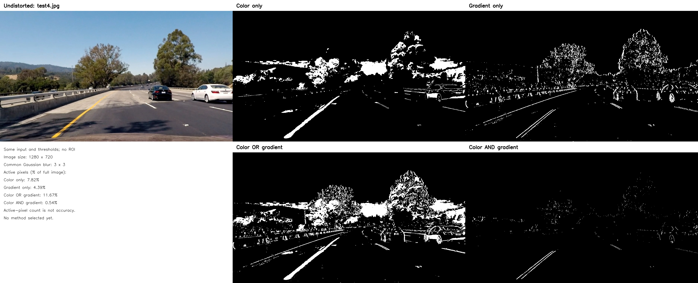

## test5.jpg

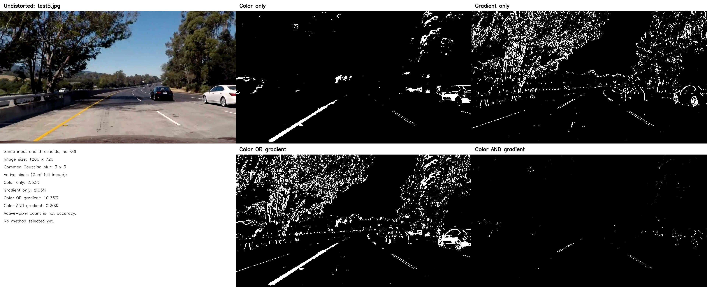

## test6.jpg

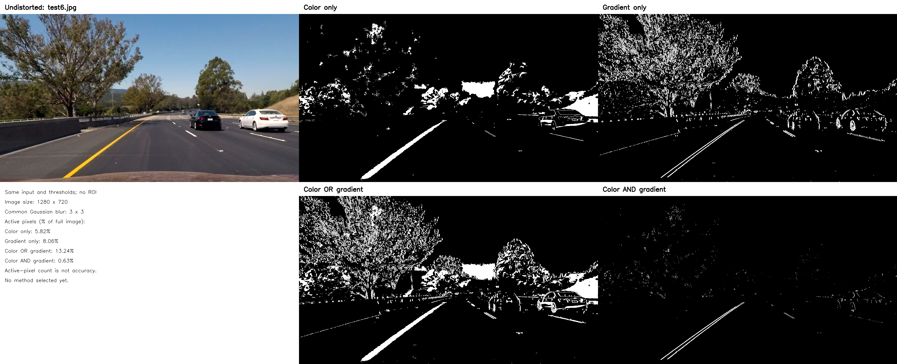

## whiteCarLaneSwitch.jpg

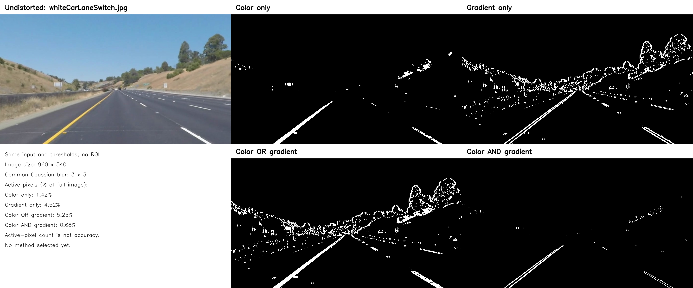
