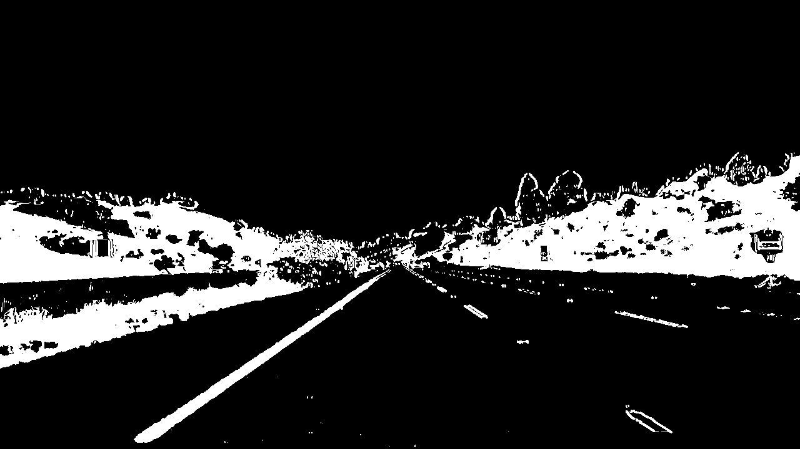
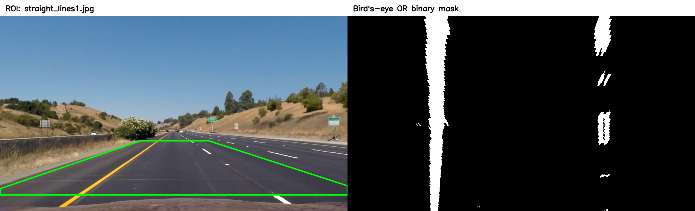

## Writeup Template

### You use this file as a template for your writeup.

---

**Lane Finding Project**

The goals / steps of this project are the following:

* Compute the camera calibration matrix and distortion coefficients given a set of chessboard images.
* Apply a distortion correction to raw images.
* Use color transforms, gradients, etc., to create a thresholded binary image.
* Apply a perspective transform to rectify binary image ("birds-eye view").
* Detect lane pixels and fit to find the lane boundary.
* Determine the curvature of the lane and vehicle position with respect to center.
* Warp the detected lane boundaries back onto the original image.
* Output visual display of the lane boundaries and numerical estimation of lane curvature and vehicle position.

[//]: # (Image References)

[image1]: ./examples/undistort_output.png "Undistorted"
[image2]: ./test_images/test1.jpg "Road Transformed"
[image3]: ./examples/binary_combo_example.jpg "Binary Example"
[image4]: ./examples/warped_straight_lines.jpg "Warp Example"
[image5]: ./examples/color_fit_lines.jpg "Fit Visual"
[image6]: ./examples/example_output.jpg "Output"
[video1]: ./project_video.mp4 "Video"

---

### Writeup / README

#### 1. Provide a Writeup that includes all the rubric points and how you addressed each one.

You're reading it!

### Camera Calibration

#### 1. Briefly state how you computed the camera matrix and distortion coefficients. Provide an example of a distortion corrected calibration image.

I calibrated the camera using the chessboard photos in camera_cal/. In camera_calibration.py, I created a 9 × 6 grid of inner corners and used cv2.findChessboardCorners() to find them in each image. Then I refined the corner positions with cv2.cornerSubPix(). Using 15 suitable images, I ran cv2.calibrateCamera() to estimate the camera matrix and five lens-distortion coefficients. Three photos didn’t show the full grid, and two had a different resolution, so I left them out. The RMS reprojection error was 0.8529 pixels. Finally, I used cv2.undistort() on each accepted calibration photo and saved 15 before-and-after comparisons to show the correction.


### Pipeline (single images)

#### 1. Provide an example of a distortion-corrected image.

I corrected the lens distortion in the road images using the camera matrix and distortion coefficients from calibration. In undistort_images.py, load_calibration() loads those values, and undistort_image() uses cv2.undistort() to fix each image. Since the road images are 960 × 540 and the calibration images are 1280 × 720, I scaled the focal lengths and principal point by 0.75 and left the distortion coefficients unchanged. This assumes both sets of images were taken with the same camera and have the same field of view. I corrected all 17 road images and saved before-and-after comparisons at their original resolutions.


#### 2. Describe how (and identify where in your code) you used color transforms, gradients or other methods to create a thresholded binary image.  Provide an example of a binary image result.

I implemented and tested several thresholding methods in `thresholding.py` to identify lane markings in the road images. The experiment included color-based and gradient-based thresholding, as well as two combinations of their results using logical OR and AND operations.

Before applying the thresholds, I corrected the lens distortion and applied a 3 × 3 Gaussian blur to reduce image noise. For color thresholding, I used the HLS color space to detect bright, low-saturation pixels corresponding to white lane marking, and HSV to detect yellows markings. For gradient thresholding, I used the absolute horizontal Sobel derivative of the grayscale image, normalized to the range 0–255, to detect changes in intensity along lane-marking edges.

I tested all four methods on the 17 road images using the same threshold values and without applying a region of interest (ROI). I saved the individual binary masks and comparison images to evaluate how well each method detected lane markings and how much unwanted detail it introduced.

Based on the visual results, I chose the OR combination for the following pipeline stages. Unlike AND, which keeps only pixels detected by both methods, OR preserves pixels detected by either color or gradient thresholding. This helps retain lane markings that might otherwise be missed by one of the methods.

The following code excerpts show the main parts of the implementation in `thresholding.py`.

**Threshold settings**

All threshold values are defined in the `ThresholdSettings` class:

```python
@dataclass(frozen=True)
class ThresholdSettings:
    blur_kernel: int = 3
    white_lightness_min: int = 200
    white_saturation_max: int = 100
    yellow_hue_min: int = 15
    yellow_hue_max: int = 40
    yellow_saturation_min: int = 80
    yellow_value_min: int = 80
    sobel_kernel: int = 3
    gradient_min: int = 30
    gradient_max: int = 255
```

**Color thresholding**

The `color_threshold()` function converts the image to HLS and HSV and creates a binary mask containing pixels that satisfy the white or yellow color thresholds.

```python
def color_threshold(image: np.ndarray, settings: ThresholdSettings) -> np.ndarray:
    hls = cv2.cvtColor(image, cv2.COLOR_BGR2HLS)
    hsv = cv2.cvtColor(image, cv2.COLOR_BGR2HSV)
    white = cv2.inRange(
        hls, (0, settings.white_lightness_min, 0),
        (179, 255, settings.white_saturation_max),
    )
    yellow = cv2.inRange(
        hsv,
        (settings.yellow_hue_min, settings.yellow_saturation_min, settings.yellow_value_min),
        (settings.yellow_hue_max, 255, 255),
    )
    return ((white != 0) | (yellow != 0)).astype(np.uint8)
```

**Gradient thresholding**

The `gradient_threshold()` function applies the Sobel operator in the horizontal direction and selects pixels whose normalized gradient magnitude falls within the specified range.

```python
def gradient_threshold(image: np.ndarray, settings: ThresholdSettings) -> np.ndarray:
    gray = cv2.cvtColor(image, cv2.COLOR_BGR2GRAY)
    sobel_x = cv2.Sobel(gray, cv2.CV_64F, 1, 0, ksize=settings.sobel_kernel)
    absolute = np.abs(sobel_x)
    maximum = float(absolute.max())
    if maximum == 0:
        return np.zeros(gray.shape, dtype=np.uint8)
    scaled = np.rint(255 * absolute / maximum).astype(np.uint8)
    return ((scaled >= settings.gradient_min) & (scaled <= settings.gradient_max)).astype(np.uint8)
```

**Combining the thresholds**

In `create_masks()`, I apply Gaussian blur before running both thresholding methods. Their results are then combined using a pixelwise OR operation:

```python
filtered = cv2.GaussianBlur(image, (settings.blur_kernel, settings.blur_kernel), 0)
color = color_threshold(filtered, settings)
gradient = gradient_threshold(filtered, settings)
union = color | gradient
```

The resulting `union` mask is a binary image containing values of 0 and 1, where 1 represents a pixel selected by at least one thresholding method. The output is saved as a black-and-white PNG in `outputs/thresholding/masks/or/`.

The following images show the selected binary mask and a comparison of all four thresholding methods.




#### 3. Describe how (and identify where in your code) you performed a perspective transform and provide an example of a transformed image.

I implemented the perspective transformation in `perspective_transform.py` to obtain a bird's-eye view of the road. This makes the lane markings appear approximately parallel, making them easier to detect and fit with polynomials in the following stages.

I selected four source points near the lane boundaries using the undistorted straight-road images. These points were mapped to a rectangle with 25% margins on both sides of the output image. The reference coordinates were `(580, 460)`, `(705, 460)`, `(1020, 660)`, and `(295, 660)` for an image resolution of 1280 × 720. For images with different resolutions, I scaled the coordinates accordingly.

The `create_perspective_transform()` function uses `cv2.getPerspectiveTransform()` to calculate the forward and inverse transformation matrices. I then used `warp_binary()` to transform the selected OR binary mask with `cv2.warpPerspective()`. Nearest-neighbor interpolation was used to preserve the binary pixel values.

To visualize the transformation, I also implemented `get_source_roi()` and `draw_region_of_interest()`. These functions determine the visible region of the original image that contributes to the bird's-eye view and outline it in green. This allows a direct comparison between the selected road region and the transformed binary image.

The following code excerpts show the main parts of the implementation.

**Perspective settings**

The reference image size, source points, and destination margins are defined in `PerspectiveSettings`:

```python
@dataclass(frozen=True)
class PerspectiveSettings:
    reference_size: tuple[int, int] = (1280, 720)
    source_points: tuple[tuple[float, float], ...] = (
        (580, 460), (705, 460), (1020, 660), (295, 660),
    )
    destination_margin: float = 0.25
```

**Calculating the transformation matrices**

In `create_perspective_transform()`, I scale the source points to match the image resolution, define the destination rectangle, and calculate both transformation matrices:

```python
source = source * np.float32([
    width / settings.reference_size[0],
    height / settings.reference_size[1],
])
margin = settings.destination_margin
destination = np.float32([
    [margin, 0], [1 - margin, 0], [1 - margin, 1], [margin, 1],
]) * np.float32([width - 1, height - 1])
matrix = cv2.getPerspectiveTransform(source, destination)
inverse_matrix = cv2.getPerspectiveTransform(destination, source)
```

**Applying the perspective transformation**

Finally, `warp_binary()` applies the transformation to the binary image:

```python
def warp_binary(binary: np.ndarray, matrix: np.ndarray) -> np.ndarray:
    height, width = binary.shape
    return cv2.warpPerspective(
        binary, matrix, (width, height), flags=cv2.INTER_NEAREST,
        borderMode=cv2.BORDER_CONSTANT, borderValue=0,
    )
```

The following comparison shows the selected region in the undistorted image and the resulting bird's-eye binary image.



#### 4. Describe how (and identify where in your code) you identified lane-line pixels and fit their positions with a polynomial?

I implemented lane pixel detection and polynomial fitting in `lane_fitting.py`. In `find_lane_pixels()`, I calculated a histogram of the nonzero pixels in the lower half of each bird's-eye binary image. The peaks in the left and right halves of the histogram were used as starting positions for the sliding-window searches.

I used nine sliding windows for each lane boundary, moving from the bottom of the image toward the top. Each window collects nearby nonzero pixels and updates its horizontal position using their median x coordinate, provided that enough pixels are detected. Windows with insufficient pixels are skipped to prevent the search from drifting toward noise, particularly in gaps between dashed lane markings.

In `fit_boundary()`, I fitted a second-degree polynomial of the form \(x = ay^2 + by + c\) to the detected pixels using `np.polyfit()`. I used row-balanced weights to reduce the influence of rows containing many detected pixels. The fitting process also includes iterative outlier rejection, removing pixels that deviate too far from the estimated curve.

Finally, I evaluated the fitted polynomials using `np.polyval()` and drew the resulting boundaries on the bird's-eye binary images, with the left boundary in green and the right in red. All 17 supplied images produced two fitted boundaries that passed the configured pixel-support and lane-width checks.

The following code excerpts show the main parts of the implementation.

**Finding lane pixels**

The `find_lane_pixels()` function calculates the histogram, initializes the sliding-window positions, and extracts the coordinates of nonzero pixels:

```python
histogram = np.count_nonzero(binary[height // 2 :], axis=0)
midpoint = width // 2
left_current = int(np.argmax(histogram[:midpoint])) if histogram[:midpoint].any() else None
right_current = midpoint + int(np.argmax(histogram[midpoint:])) if histogram[midpoint:].any() else None
margin = max(2, int(round(width * settings.margin_fraction)))
minimum_pixels = max(10, int(round(binary.size * settings.minimum_window_pixel_fraction)))
nonzero_y, nonzero_x = np.nonzero(binary)
edges = np.linspace(height, 0, settings.windows + 1, dtype=int)
```

The sliding windows then collect nearby pixels and update their positions:

```python
left_indices = []
right_indices = []

for bottom, top in zip(edges[:-1], edges[1:]):
    in_band = (nonzero_y >= top) & (nonzero_y < bottom)
    if left_current is not None:
        selected = np.flatnonzero(in_band & (np.abs(nonzero_x - left_current) <= margin))
        if selected.size >= minimum_pixels:
            left_indices.extend(selected)
            left_current = int(np.median(nonzero_x[selected]))
    if right_current is not None:
        selected = np.flatnonzero(in_band & (np.abs(nonzero_x - right_current) <= margin))
        if selected.size >= minimum_pixels:
            right_indices.extend(selected)
            right_current = int(np.median(nonzero_x[selected]))
```

The selected pixel coordinates are returned separately for the left and right boundaries:

```python
left_indices = np.asarray(left_indices, dtype=int)
right_indices = np.asarray(right_indices, dtype=int)
return (
    nonzero_x[left_indices], nonzero_y[left_indices],
    nonzero_x[right_indices], nonzero_y[right_indices],
)
```

**Polynomial fitting**

In `fit_boundary()`, I used weighted polynomial fitting with iterative outlier rejection. The following loop fits a polynomial, calculates the residuals, and removes pixels that deviate too far from the fitted curve:

```python
for _ in range(settings.refinement_iterations):
    counts = np.bincount(pixel_y[keep], minlength=height)
    weights = 1 / np.sqrt(counts[pixel_y[keep]])
    coefficients = np.polyfit(pixel_y[keep], pixel_x[keep], 2, w=weights)
    residuals = pixel_x - np.polyval(coefficients, pixel_y)
    center = float(np.median(residuals[keep]))
    deviation = float(np.median(np.abs(residuals[keep] - center)))
    limit = max(width * settings.minimum_residual_fraction, settings.outlier_sigma * 1.4826 * deviation)
    refined = np.abs(residuals - center) <= limit
    if np.array_equal(refined, keep) or not sufficient_support(refined):
        break
    keep = refined
```

After refinement, the final polynomial coefficients are calculated using the retained pixels:

```python
counts = np.bincount(pixel_y[keep], minlength=height)
weights = 1 / np.sqrt(counts[pixel_y[keep]])
coefficients = np.polyfit(pixel_y[keep], pixel_x[keep], 2, w=weights)
```

The resulting curves are drawn on the bird's-eye binary image.


#### 5. Describe how (and identify where in your code) you calculated the radius of curvature of the lane and the position of the vehicle with respect to center.

I implemented the lane curvature and vehicle position calculations in `lane_metrics.py`, using the polynomial coefficients obtained in the previous stage.

To convert pixel measurements into meters, I assumed a lane width of 3.7 m and a visible road length of 30 m. The horizontal scale was calculated from the width of the destination rectangle in the perspective transformation, while the vertical scale was based on the full height of the bird's-eye image.

Using these scales, I converted the polynomial coefficients from pixels to meters and calculated the radius of curvature at the bottom of the bird's-eye image, representing the nearest visible part of the road. I calculated separate radii for the left and right boundaries and for the lane centerline, obtained by averaging their polynomial coefficients.

For a lane boundary described by $x(y) = Ay^2 + By + C$ in meters, the radius of curvature is:

$$
R(y) = \frac{\left[1 + (2Ay + B)^2\right]^{3/2}}{|2A|}
$$

Here, $2Ay+B$ is the first derivative and $2A$ is the second derivative of the fitted polynomial. A straight line has an infinite radius of curvature.

To estimate the vehicle's lateral position, I calculated the midpoint between the fitted boundaries at the bottom of the image. I compared this with the assumed vehicle centerline, projected into the bird's-eye view using the inverse perspective matrix. The difference was converted to meters: a positive offset indicates the vehicle is right of the lane center, and a negative offset indicates it is left.

These measurements are approximate because they depend on the assumed road dimensions and on the camera being centered and aligned with the vehicle.

**Converting the fitted polynomials to meters**

In `measure_lane_geometry()`, the horizontal and vertical scales are used to convert the boundary polynomials:

```python
x_m_per_pixel = settings.lane_width_m / reference_lane_width
y_m_per_pixel = settings.visible_road_length_m / (height - 1)
left_m = polynomial_in_meters(left_coefficients, x_m_per_pixel, y_m_per_pixel)
right_m = polynomial_in_meters(right_coefficients, x_m_per_pixel, y_m_per_pixel)
center_m = (left_m + right_m) / 2
evaluation_y = float(height - 1)
evaluation_y_m = evaluation_y * y_m_per_pixel
```

The coefficient conversion in `polynomial_in_meters()` is:

```python
return coefficients * np.array([
    x_m_per_pixel / y_m_per_pixel**2,
    x_m_per_pixel / y_m_per_pixel,
    x_m_per_pixel,
])
```

**Calculating curvature**

The `radius_of_curvature()` function implements the equation above:

```python
def radius_of_curvature(coefficients_m: np.ndarray, y_m: float) -> float:
    a, b, _ = coefficients_m
    second_derivative = 2 * float(a)
    if abs(second_derivative) <= 1e-12:
        return float("inf")
    slope = 2 * float(a) * y_m + float(b)
    return float((1 + slope**2)**1.5 / abs(second_derivative))
```

**Estimating vehicle position**

The `vehicle_reference_x()` function projects the assumed vehicle centerline into the bird's-eye view:

```python
def vehicle_reference_x(
    inverse_matrix: np.ndarray, image_width: int,
    evaluation_y: float, vehicle_center_fraction: float,
) -> float:
    source_center_x = vehicle_center_fraction * (image_width - 1)
    source_centerline = np.array([1.0, 0.0, -source_center_x])
    bird_centerline = inverse_matrix.T @ source_centerline
    if not np.isfinite(bird_centerline).all() or abs(bird_centerline[0]) <= 1e-12:
        raise ValueError("Cannot intersect the projected vehicle centerline with the evaluation row.")
    return float(-(bird_centerline[1] * evaluation_y + bird_centerline[2]) / bird_centerline[0])
```

In `measure_lane_geometry()`, the signed lateral offset is calculated as follows:

```python
left_x = float(np.polyval(left_coefficients, evaluation_y))
right_x = float(np.polyval(right_coefficients, evaluation_y))
if right_x <= left_x:
    raise ValueError("Lane boundaries must be ordered left to right at the evaluation row.")
lane_center_x = (left_x + right_x) / 2
vehicle_x = vehicle_reference_x(
    inverse_matrix, width, evaluation_y, settings.vehicle_center_fraction,
)
offset_m = (vehicle_x - lane_center_x) * x_m_per_pixel
```

Finally, the radii are calculated for both boundaries and the centerline:

```python
radii = {
    "left": radius_of_curvature(left_m, evaluation_y_m),
    "right": radius_of_curvature(right_m, evaluation_y_m),
    "center": radius_of_curvature(center_m, evaluation_y_m),
}
```


#### 6. Provide an example image of your result plotted back down onto the road such that the lane area is identified clearly.

TODO: Add your text here!!!

### Pipeline (video)

#### 1. Provide a link to your final video output.  Your pipeline should perform reasonably well on the entire project video (wobbly lines are ok but no catastrophic failures that would cause the car to drive off the road!).

TODO: Add your text here!!!

### Discussion

#### 1. Briefly discuss any problems / issues you faced in your implementation of this project.  Where will your pipeline likely fail?  What could you do to make it more robust?

TODO: Add your text here!!!

