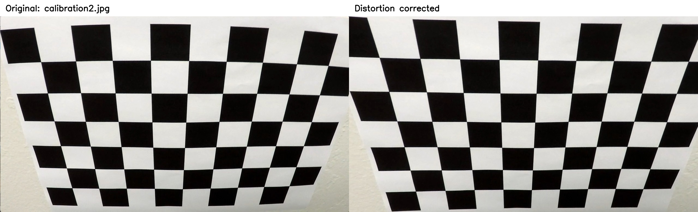
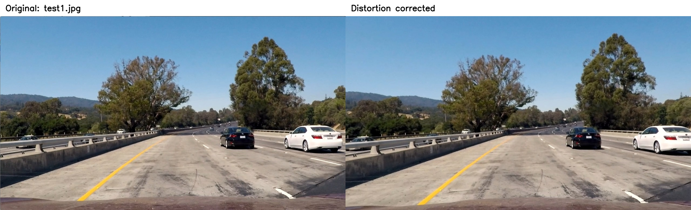

## Writeup Template

### You use this file as a template for your writeup.

---

**Lane Finding Project**

The goals / steps of this project are the following:

* Compute the camera calibration matrix and distortion coefficients given a set of chessboard images.
* Apply a distortion correction to raw images.
* Use color transforms, gradients, etc., to create a thresholded binary image.
* Apply a perspective transform to rectify binary image ("birds-eye view").
* Detect lane pixels and fit to find the lane boundary.
* Determine the curvature of the lane and vehicle position with respect to center.
* Warp the detected lane boundaries back onto the original image.
* Output visual display of the lane boundaries and numerical estimation of lane curvature and vehicle position.

[//]: # (Image References)

[image1]: ./examples/undistort_output.png "Undistorted"
[image2]: ./test_images/test1.jpg "Road Transformed"
[image3]: ./examples/binary_combo_example.jpg "Binary Example"
[image4]: ./examples/warped_straight_lines.jpg "Warp Example"
[image5]: ./examples/color_fit_lines.jpg "Fit Visual"
[image6]: ./examples/example_output.jpg "Output"
[video1]: ./project_video.mp4 "Video"

---

### Writeup / README

#### 1. Provide a Writeup that includes all the rubric points and how you addressed each one.

You're reading it!

### Camera Calibration

#### 1. Briefly state how you computed the camera matrix and distortion coefficients. Provide an example of a distortion corrected calibration image.

I calibrated the camera using the chessboard photos in camera_cal/. In camera_calibration.py, I created a 9 × 6 grid of inner corners and used cv2.findChessboardCorners() to find them in each image. Then I refined the corner positions with cv2.cornerSubPix(). Using 15 suitable images, I ran cv2.calibrateCamera() to estimate the camera matrix and five lens-distortion coefficients. Three photos didn’t show the full grid, and two had a different resolution, so I left them out. The RMS reprojection error was 0.8529 pixels. Finally, I used cv2.undistort() on each accepted calibration photo and saved 15 before-and-after comparisons to show the correction.

### Pipeline (single images)

#### 1. Provide an example of a distortion-corrected image.

I corrected the lens distortion in the road images using the camera matrix and distortion coefficients from calibration. In undistort_images.py, load_calibration() loads those values, and undistort_image() uses cv2.undistort() to fix each image. Since the road images are 960 × 540 and the calibration images are 1280 × 720, I scaled the focal lengths and principal point by 0.75 and left the distortion coefficients unchanged. This assumes both sets of images were taken with the same camera and have the same field of view. I corrected all 17 road images and saved before-and-after comparisons at their original resolutions.

#### 2. Describe how (and identify where in your code) you used color transforms, gradients or other methods to create a thresholded binary image.  Provide an example of a binary image result.

TODO: Add your text here!!!

#### 3. Describe how (and identify where in your code) you performed a perspective transform and provide an example of a transformed image.

TODO: Add your text here!!!

#### 4. Describe how (and identify where in your code) you identified lane-line pixels and fit their positions with a polynomial?

TODO: Add your text here!!!

#### 5. Describe how (and identify where in your code) you calculated the radius of curvature of the lane and the position of the vehicle with respect to center.

TODO: Add your text here!!!

#### 6. Provide an example image of your result plotted back down onto the road such that the lane area is identified clearly.

TODO: Add your text here!!!

### Pipeline (video)

#### 1. Provide a link to your final video output.  Your pipeline should perform reasonably well on the entire project video (wobbly lines are ok but no catastrophic failures that would cause the car to drive off the road!).

TODO: Add your text here!!!

### Discussion

#### 1. Briefly discuss any problems / issues you faced in your implementation of this project.  Where will your pipeline likely fail?  What could you do to make it more robust?

TODO: Add your text here!!!

